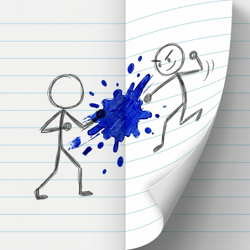

# Paper Fold Battle

**Hide your stick army. Memorize the enemy. Fold the paper to strike!**

Paper Fold Battle is a free iPhone game based on the classic pen-and-paper classroom game.
Each player hides 5 stick soldiers on their half of a notebook page, marks a blue ink dot,
and folds the paper. The ink lands on the mirrored spot on the enemy's side, and any soldier
it touches is out.

This repository hosts the game's website (GitHub Pages):

| Home | https://yeonggwoncho-create.github.io/PaperFoldBattle

| Support | https://yeonggwoncho-create.github.io/PaperFoldBattle/support.html

| Privacy Policy | https://yeonggwoncho-create.github.io/PaperFoldBattle/privacy.html

## Features

- **Play in Room.** Create a room, share the 6-character code, and play on two phones. No account needed.
- **Memory battle.** Enemy soldiers are shown for 3 seconds, then hidden.
- **Fair-play Peeks.** See the enemy again for 2 seconds, but it costs your attack. The first attacker gets 3 Peeks; the player going second gets 4.
- **One round.** Every battle is a single round: the first to wipe out all 5 enemy soldiers wins.
- **Custom sizes.** The host sets the soldier and ink-dot size with live sliders.
- **Play in One Screen** works fully offline.

## How to play

1. Hide your 5 soldiers on your half of the page.
2. Memorize the enemy army during the 3-second reveal.
3. On your turn, tap your own half to place a blue ink dot.
4. Press **FOLD**. The ink transfers to the mirror spot on the enemy half.
5. **HIT!** crosses out a soldier; otherwise it's a **MISS**. Take turns until one army is gone.

## Built with

React Native, Expo, TypeScript, Firebase Realtime Database, Google AdMob

## Contact

Questions, bugs or ideas: **yeonggwoncho@gmail.com**

Copyright 2026 Yeonggwon Cho
